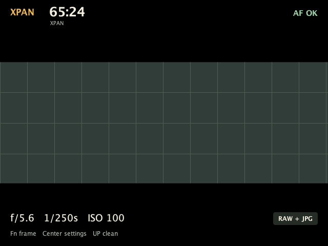
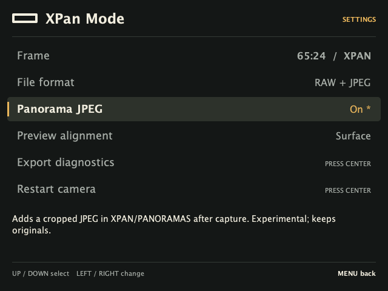

# XPan Mode for Sony A7 II

A small, buildable PlayMemories camera app for **Sony ILCE-7M2**, with a black panoramic live-view mask and native camera capture. **Prototype: 0.3.0 builds and passes host checks; on-camera JPEG export awaits a device test. Versions 0.1.0 and 0.2.0 were installed on ILCE-7M2 firmware 4.01; the owner confirms live preview and shutter capture. EVF operation and precise framing alignment still require testing.**

- [Prototype release](https://github.com/szabadkai/sony-a7ii-xpan/releases/tag/v0.3.0-prototype) · [Signed APK](dist/XPanMode-0.3.0-prototype.apk) · [SHA-256](dist/XPanMode-0.3.0-prototype.apk.sha256)
- [Build instructions](docs/BUILD.md)
- [Install / remove / recover](docs/INSTALL.md)
- [On-camera panoramic JPEG export](docs/ON_CAMERA_JPEG.md)
- [User guide](docs/USER_GUIDE.md) · [Panoramic RAW DNG workflow](docs/RAW_WORKFLOW.md)
- [Hardware test checklist](docs/HARDWARE_TEST.md)
- [Local validation results](docs/VALIDATION.md)
- [Research](RESEARCH.md) · [Implementation and limitations](docs/IMPLEMENTATION.md) · [Progress](PROGRESS.md)

## Interface


Version 0.2.0 adds a panoramic launcher icon, ivory/amber interface, clearer settings selection and help, a RAW/JPEG badge, and an optional clean shooting view (press **UP**). Errors and capture progress remain visible in clean view.




These are **host-rendered layouts on a synthetic grid**, generated from the app’s drawing code. They are not camera screenshots or evidence of LCD/EVF operation. Android font rendering may differ.

## Why this exists

Panoramic composition is easier when the frame is visible while shooting. This project explores a 65:24 viewfinder experience on an existing A7 II, while retaining the full image for later editing. It is an independent project inspired by XPan framing, with no affiliation to Sony, Hasselblad or Fujifilm.

## Hardware status

| Check | Result |
| --- | --- |
| 0.3.0 build, signature and source reproduction | Verified locally |
| Installation on ILCE-7M2 firmware 4.01 | 0.1.0 and 0.2.0 verified |
| Live preview and physical shutter operation | Owner reports working in 0.2.0 |
| 0.3.0 on-camera cropped JPEG export | Implemented; device test pending |
| RAW processing | One camera ARW converted to panoramic RAW DNG; pixel checksums match |
| Accurate LCD/EVF mask and eye-sensor switching | Not yet verified |

Reports are welcome through the [hardware-test issue form](https://github.com/szabadkai/sony-a7ii-xpan/issues/new?template=hardware-test.yml). See [contributing](CONTRIBUTING.md) and the [test checklist](docs/HARDWARE_TEST.md); report observations separately for each display.

## Implemented

Native Sony CameraEx preview/capture, physical half/full shutter, full-size 3:2 RAW+JPEG negotiation, single-shot mode, autofocus requests, inherited exposure/WB, aperture/shutter controls, return-to-preview handling, lifecycle release, persisted aspect/output selection, display diagnostics and a visible EVF probe. Five composition ratios: **65:24**, 2.39:1, 3:1, 16:9, 3:2. The black mask is mapped from sensor coordinates into the preview surface, with an experimental Sony VideoRect mapping option for hardware calibration.

The app requests full-size RAW+JPEG by default and refuses capture if that configuration cannot be established. JPEG-only is an explicit menu choice. It never crops or edits RAW files, accesses backup-setting stores, patches firmware, or automatically installs itself.

## Build

Requires macOS (Apple Silicon with Rosetta 2, or Intel) or Linux x86_64, Python 3, curl, unzip and tar.

```sh
python3 scripts/bootstrap.py
./scripts/build.sh
```

The bootstrap installs a pinned, checksum-verified toolchain under `.toolchain/`, not globally. The APK uses API 10, DEX 035 and v1 signing. No Gradle, NDK, AndroidX or firmware libraries are bundled. A reusable local signing key is created in `.keys/`; keep it for future updates.

## Cropped JPEGs on the camera

Version 0.3.0 adds **Panorama JPEG → On** (default): after capture it attempts to create a new 6000×2215 JPEG for 65:24, retaining the full-frame originals. The export uses short strips to limit memory use and writes into `XPAN/PANORAMAS`. Native camera playback indexing and storage visibility remain unverified. [Usage and focused device test](docs/ON_CAMERA_JPEG.md).

## Panoramic RAW output

The desktop companion can create a **6000×2215 default-cropped RAW DNG** from an A7 II ARW. It preserves the full RAW mosaic and embeds the original ARW. One real camera file passed pixel-checksum comparison, original-file recovery and macOS rendering checks.

```sh
.venv/bin/pip install -r tools/requirements-raw.txt
python3 scripts/bootstrap-raw.py
.venv/bin/python tools/raw_panorama.py DSC00001.ARW DSC00001-xpan.dng
```

This runs after import on the computer; the camera still records full-frame ARWs. The DNG crop does not reduce the stored sensor data. [Setup, compatibility and validation](docs/RAW_WORKFLOW.md).

## Desktop panorama export

```sh
python3 -m venv .venv
.venv/bin/pip install -r tools/requirements.txt
.venv/bin/python tools/crop.py DSC00001.JPG DSC00001-xpan.jpg --ratio 65:24
XPAN_PYTHON=.venv/bin/python ./scripts/test.sh
```

Export operates on a full-frame JPEG or developed TIFF/PNG, never an ARW. It refuses to overwrite files and writes a crop-record JSON beside the result. On a 6000×4000 landscape image the crop is `(0, 892, 6000, 3107)` → **6000×2215**, retaining the original full frame. See the user guide for portrait orientation and RAW-development alignment.

## Evidence boundary

Host tests verify the crop math, lifecycle capture gate, reflection names against upstream SDK declarations, non-overwrite export and APK structure/signing. Host tests cannot validate Sony firmware behavior. The owner subsequently confirmed preview and shutter capture; the RAW companion was also tested on an actual file retrieved from the camera. The next step is the owner-run LCD/EVF and capture checklist, beginning with a spare card and the magenta C1 probe. The owner-authorized installation has since succeeded; see [0.2.0 installation evidence](docs/INSTALLATION_RESULT_0.2.0.json).

MIT license; third-party notices are in `third_party/`.
